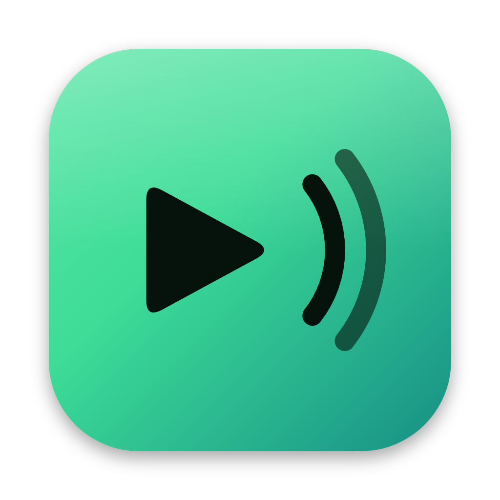
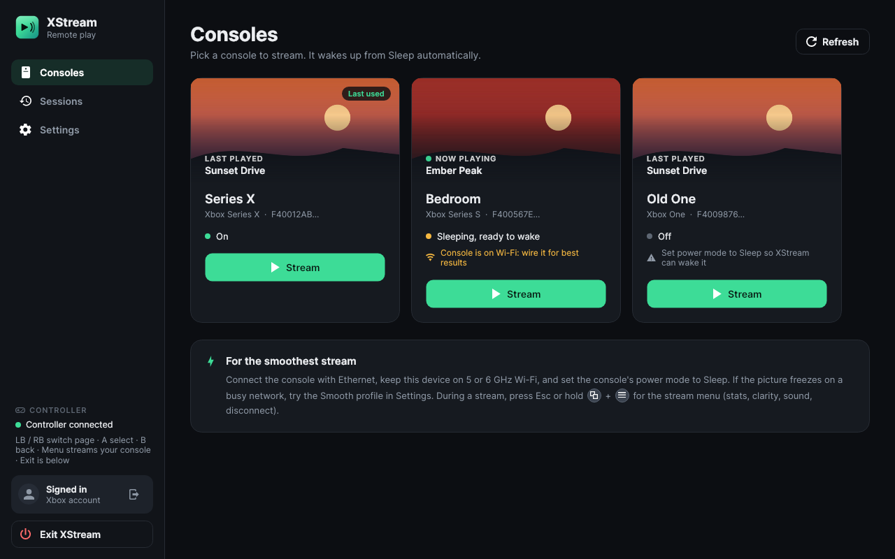
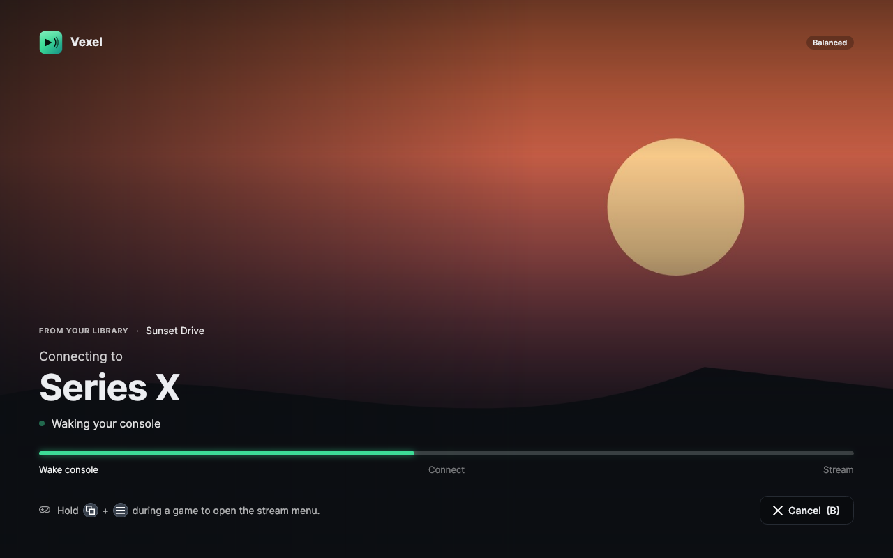
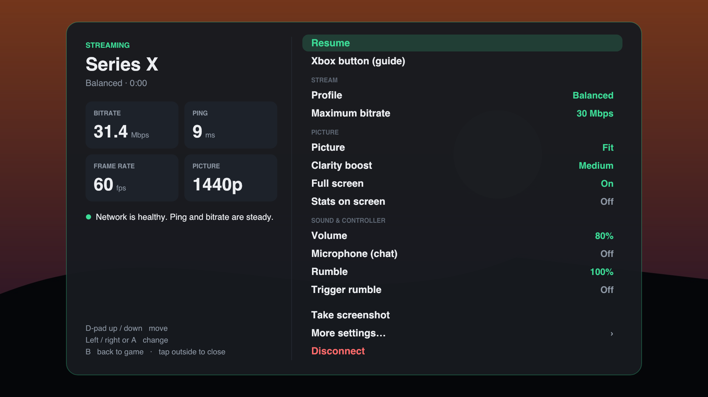
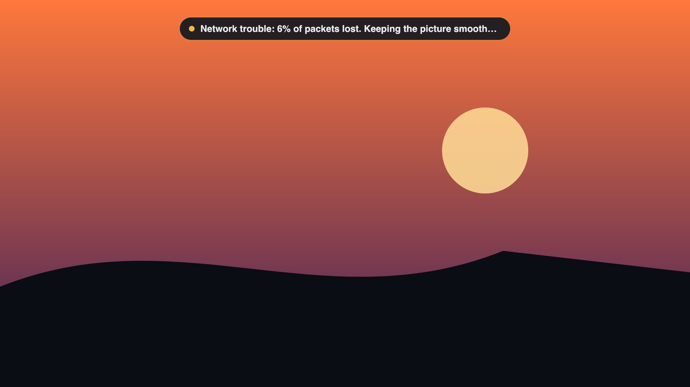
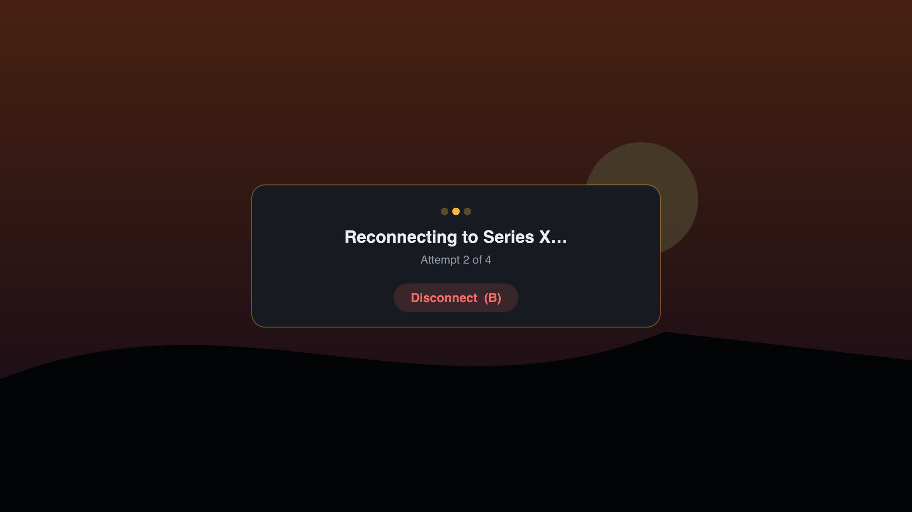
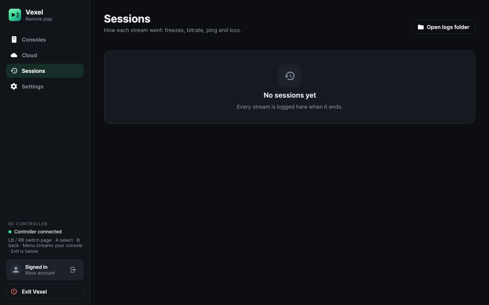
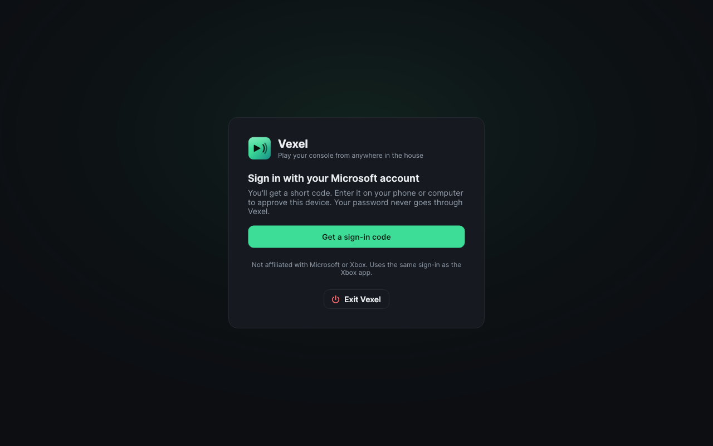

> **Built with AI.** Vexel is a personal project, built out of a desire to get as much performance out of remote play as possible.

<p align="center">
  
</p>

<h1 align="center">Vexel</h1>

<p align="center">
  <b>Play your Xbox from anywhere in the house.</b><br />
  A fast, controller-first remote play app for streaming your Xbox console to Windows handhelds like the ROG Ally, and to PCs and Macs.
</p>

<p align="center">
  
</p>

Vexel streams your Xbox console over your home network. It's built for playing with a controller: it opens full screen, every menu works with the D-pad, and an in-game menu is one button combo away. It keeps the picture smooth and the latency low with adaptive bitrate, hardware decoding and automatic reconnects, and it tells you plainly when the connection is struggling.

> Vexel is an independent, open-source project. It is not affiliated with, endorsed by or supported by Microsoft or Xbox. It uses the same unofficial streaming service as the Xbox web player, which Microsoft can change at any time.

## Features

- **Your console and the cloud:** stream your own Xbox, or play **Xbox Cloud Gaming** games with Game Pass Ultimate, no console needed. Both get the same player, menu and controls.
- **Controller-first:** full screen on handhelds, D-pad navigation everywhere, and controller and connection status at a glance.
- **Your games, front and centre:** each console card shows the game running on it (or your last played game), and the connecting screen fills the display with art from your library.
- **In-game stream menu:** hold <kbd>View</kbd> + <kbd>Menu</kbd> (or tap the screen) to change bitrate, picture, clarity, volume, rumble and microphone without leaving the game.
- **Stable streaming:**
  - adaptive bitrate that backs off before the picture freezes
  - lost-packet recovery
  - fast keyframe repair
  - automatic reconnect when the connection drops
- **Low latency:**
  - hardware decoding drawn straight from the GPU (Direct3D 11 on Windows, Metal on macOS)
  - controller input sent the instant it changes
  - no frames queued for display
- **Clear feedback:** short messages when the network, frame rate or battery needs attention, and when things are back to normal.
- **Sharper picture:**
  - **Quality:** Sharpest (1440p, 4K where offered) or Fastest (720p, about 10 ms quicker and far less data)
  - **Enhance:** a stream smaller than your screen is enlarged edge-aware, in the style of AMD FSR 1, so text and edges stay crisp
  - an optional halo-free Clarity boost, plus Fit, Fill and Stretch for screens that aren't 16:9
- **Connection advice:**
  - while connecting, a warning if this device is on 2.4 GHz or weak Wi-Fi, or the console is on Wi-Fi;
  - about 20 seconds in, if the stream's own numbers show trouble, a short message and **Connection tips** in the stream menu, with **Suggested settings** to apply a fix;
  - the tips again in the summary after the stream;
  - **Test connection** on the Sessions page runs a 12-second test stream before you play.
- **Stats on screen:** F3 (or the stream menu) shows a one-line readout; press again for a detailed panel with where the delay goes, the network, the picture, the controller and the last minute as a graph.
- **Play from anywhere:** at home or away. Vexel finds a direct path to your console over the internet, and shows which route it's using.
- **Type on the console:** type with a keyboard, or the touch keyboard on a handheld, and the text goes straight into the console's text box (search, sign-ins, messages), updating as you type.
- **Console control:** turn your Xbox off or restart it from its card, or end a stream with "End and turn off Xbox". Pick a recent game under **Jump back in** to start it on the console and stream it as it opens.
- **Picks up after sleep:** put a handheld to sleep mid-game and the stream reconnects by itself when it wakes, once Wi-Fi is back.
- **Instant replay:** keep the last 30 seconds and save them as an MP4 clip (F10, or the stream menu). Off by default.
- **Keyboard and mouse:** play without a controller. WASD and the mouse drive the sticks, clicks are the triggers, and every key can be changed on the Mapping page. On by default when no controller is connected; click the picture to start.
- **Your controller, your layout:** the **Mapping** page shows your games with their art and a picture of the controller: click a button to change what it does. Give each game its own layout and Vexel switches to it by itself when that game starts, even mid-stream. Elite / DualSense Edge back paddles, and gyro aiming on a DualSense, DualShock 4 or Switch Pro controller.
- **Launch shortcuts:** add Vexel to Steam, Armoury Crate or Playnite with `--stream` and go straight into a stream (see [Shortcuts](#shortcuts)).
- **Party chat and Discord:** your mic goes to the console, so Xbox party chat works, and so does Discord voice moved to the Xbox (Discord app: join a voice channel, then Transfer to Xbox). F9 or a controller button (a back paddle suits it) mutes, or is held to talk with push to talk. The stream menu mutes the mic while open, and a small icon shows when you're muted or talking. Pick the microphone and test its level in Settings. **Party & Discord chat…** in the stream menu opens the console's guide.
- **Friends and achievements:** the **Friends** page shows who's online and what they're playing, and your games' achievements and gamerscore. Unlocks pop up while you stream.
- **Game audio, rumble and screenshots.**
- **Made for the ROG Ally:**
  - runs the 120 Hz panel at the stream's 60 Hz
  - keeps the device awake
  - turns off Wi-Fi background scans while streaming
  - warns when the battery is low
- **Discord status:** "Playing *game* via Vexel" while you stream.
- **Safe updates:** new versions install themselves on Windows and Mac, and every update is checked against Vexel's signature first.

## Screenshots

| Connecting | In-game stream menu |
|---|---|
|  |  |

| Connection message | Reconnecting |
|---|---|
|  |  |

| Settings | Sign in |
|---|---|
|  |  |

<sub>Screenshots use placeholder artwork. In the app you see art from your own game library.</sub>

## Getting started

### What you need

- **An Xbox Series X|S or Xbox One** with remote play turned on:
  1. On the console, go to **Settings → Devices & connections → Remote features**.
  2. Turn on **Enable remote features**.
  3. Under **Power mode**, choose **Sleep**, so Vexel can wake the console.
- **A Windows 10 or 11 PC or handheld** (x64), or **a Mac with Apple Silicon** (macOS 13 or later).
- **A good home network.** The console on Ethernet and this device on 5 or 6 GHz Wi-Fi works best.

### Install (Windows)

1. Download **Vexel.exe** from the [latest release](../../releases/latest).
2. Run it. It's a single file with nothing to install. The first launch unpacks its video libraries, which takes a few seconds, behind a progress window.
3. Sign in with your Microsoft account. Vexel shows a short code that you approve on your phone or computer, so your password never goes through Vexel.
4. Pick your console and press **Stream**.

From then on, Vexel updates itself: new versions download in the background and install when you restart.

> If Windows shows "Windows protected your PC", choose **More info → Run anyway**. This happens with new releases until they build reputation with Microsoft SmartScreen.

**Code signing:** Windows releases are signed through the SignPath Foundation. Free code signing is provided by [SignPath.io](https://about.signpath.io), with the certificate from [SignPath Foundation](https://signpath.org). See the [code signing policy](docs/CODE_SIGNING.md).

### Install (Mac)

1. Download **Vexel-mac.zip** from the [latest release](../../releases/latest) and open it.
2. Drag **Vexel** to Applications.
3. The first time, right-click Vexel and choose **Open**, then **Open** again. Vexel isn't notarized by Apple (that needs a paid Apple developer account), so macOS asks once.

From then on Vexel updates itself, like the Windows version: new versions download in the background, are checked against Vexel's signature, and install when you restart. Updates don't bring the macOS prompt back.

### Cloud gaming (no console needed)

Open **Cloud** in the sidebar to play Xbox Cloud Gaming games from Microsoft's servers. You get the same player, stream menu, controls and connection messages as for your console.

- **What you need:** **Xbox Game Pass Ultimate** for the full cloud library. Without it, free-to-play games (such as Fortnite) still work where cloud gaming is offered. Cloud gaming isn't available in every country.
- **How it works:** recently played games come first, then your whole library, with search. Pick a game and Vexel finds a server.
- **Queues:** at busy times there may be a queue, and the connecting screen shows the estimated wait.
- **Picture:** cloud streams run at up to 1080p. A Series X at home can send 1440p.

### Playing away from home

Vexel works over the internet as well as on your home network. You don't need to set anything up in Vexel, but your home network has to let the console be reached:

1. On the Xbox, open **Settings → General → Network settings** and check the **NAT type**:
   - **Open** or **Moderate** works.
   - **Strict** usually won't connect. Turn on **UPnP** in your home router's settings, then choose **Test NAT type** on the Xbox.
2. Keep **remote features** on, with power mode on **Sleep**. Vexel wakes the console from anywhere.
3. Away from home, you need a reasonable connection: about 15 Mbps or more, and ideally under about 60 ms ping to home. Choose the **Smooth** profile for patchy networks.

**How it connects:** Vexel asks public STUN servers (Google's and Cloudflare's) for its own internet address, then exchanges addresses with the console through Xbox's servers. The two connect directly, and the game stream never passes through anyone else's servers. The stream menu shows the route (*Home network* or *Internet*), and the full details are in the session log.

**If it can't connect away from home**, Vexel says so instead of hanging. Some networks block direct connections, notably workplaces, hotels and some mobile carriers. Two ways round that:

- **A VPN back to your home network.** For example, [Tailscale](https://tailscale.com/kb/1019/subnets) or WireGuard with a "subnet router" at home. Vexel then sees the console as if you were home.
- **Your own TURN relay server.** For example [coturn](https://github.com/coturn/coturn). Add it to `settings.json` in `%USERPROFILE%\.xstream` (`~/.xstream` on macOS):
  ```json
  "IceServers": [
    "stun:stun.l.google.com:19302",
    "turn:turn.example.com:3478;username;password"
  ]
  ```
  The stream then travels through your relay when no direct path exists. That adds a little latency.

### Controls

| | Controller | Keyboard / touch |
|---|---|---|
| Move around the launcher | D-pad or left stick | Arrow keys, mouse |
| Select / back | A / B | Enter / Esc |
| Switch page | LB / RB | Ctrl+Tab |
| Stream the last-used console | Menu | |
| **Open the stream menu in a game** | Hold **View + Menu** | Esc, or tap the screen |
| Xbox button (guide) | Your pad's Xbox button, or stream menu → Xbox button | |
| Screenshot | Stream menu → Take screenshot | F12 |
| Save the last 30 seconds (instant replay on) | Stream menu → Save last 30 seconds | F10 |
| Type on the console | Stream menu → Type on the console (opens the touch keyboard) | Just start typing; Enter finishes, Esc closes |
| Full screen / stats readout | Stream menu | F11 / F3 |
| Mute the mic (or hold it, with push to talk) | Microphone button (Settings) | F9 |
| Leave the launcher's full screen | | F11 |

While the stream menu is open, the console gets no controller input, so you can change settings mid-game safely.

Typing, Turn off, Restart and Jump back in use the console's remote features (the same ones the Xbox mobile app uses), so **Enable remote features** must be on. They work for your own console, not for cloud games.

### Shortcuts

Add Vexel as a game in Steam ("Add a non-Steam game"), Armoury Crate or Playnite, with launch options. If Vexel is already open, the shortcut hands the stream to it instead of opening a second copy.

| Launch options | What it does |
|---|---|
| `--stream` | Streams the last console you used |
| `--stream "Living Room"` | Streams that console (its name or id) |
| `--game 9NKX70BBCDRN --stream "Living Room"` | Starts that game (its Microsoft Store id) on the console, then streams it |
| `--cloud FORTNITE` | Plays that Xbox Cloud Gaming title |

**Settings → Launcher → Shortcuts** shows the app's path and copies the options for you.

### Tips for the smoothest stream

- **Profile:** use **Balanced** (the default). Switch to **Competitive** for the lowest latency on a good network, or **Smooth** to ride out busy Wi-Fi.
- **Freezes or blockiness:** lower **Maximum bitrate** in the stream menu.
- **Ally frame rate:** if the frame rate drops on an Ally, turn **Clarity boost** off.
- **Diagnostics:** **Settings → Export diagnostics** creates a zip of recent session logs and device information, never your sign-in details, to attach to a bug report.

## Privacy

- **Sign-in:** your sign-in is stored only on your device, in `~/.xstream` (`%USERPROFILE%\.xstream` on Windows), along with your settings, session logs and cached game art. Signing out deletes the sign-in and the cached art.
- **Services Vexel talks to:**
  - Microsoft's sign-in and Xbox services: the console list, streaming, your recently played games and what's playing now, and the console remote-control service when you type, turn the console off or start a game
  - public STUN servers (Google, Cloudflare), which only see your internet address. They tell Vexel that address so it can connect to the console from away from home. The game stream doesn't pass through them.
  - the Microsoft Store image service and the Game Pass catalogue, for game names and art
  - the update feed
  - the Discord app on your own device, if it's running and the Discord setting is on
- **No telemetry:** Vexel sends no analytics and no crash reports. Diagnostics only leave your device if you send the zip yourself.

## Building from source

You need the [.NET 10 SDK](https://dotnet.microsoft.com/download), plus SDL2 and FFmpeg. libopus is optional: game audio decodes faster with it, and falls back to a built-in decoder without it.

- **macOS:**
  ```
  brew install ffmpeg sdl2 opus
  ```
- **Windows:** put `SDL2.dll` and the FFmpeg shared DLLs (`avcodec-*.dll`, `avutil-*.dll`, `swresample-*.dll`) next to the app, or set `XSTREAM_FFMPEG` to their folder. Optionally add `opus.dll` (`./scripts/build-opus-windows.sh` builds it).

```bash
./scripts/get-sipsorcery.sh            # once: patched WebRTC library (Windows: scripts/get-sipsorcery.ps1)
dotnet run --project src/XStream.App   # the launcher
dotnet run --project tests/XStream.Tests
```

**Mac release build:** `./scripts/publish-macos.sh` makes `dist/Vexel-mac.zip` with Vexel.app (self-contained, with SDL2 and libopus inside; video is decoded by macOS).

**Windows release build:** `./scripts/publish-windows.sh` makes `dist/Vexel.exe`, a single self-contained file. It runs on macOS, Linux or Git Bash. Run `./scripts/build-ffmpeg-windows.sh` first (it needs MinGW-w64 and nasm) for a minimal LGPL FFmpeg; that brings the exe down to about 30 MB. Run `./scripts/build-opus-windows.sh` too, for libopus. The full release process (GitHub build, code signing and signed update manifests) is in [docs/RELEASING.md](docs/RELEASING.md). The code-signing policy is in [docs/CODE_SIGNING.md](docs/CODE_SIGNING.md).

**Command-line client:** useful for testing without the UI:

```bash
dotnet run --project src/XStream.Cli -- login            # sign in with a code
dotnet run --project src/XStream.Cli -- consoles         # list consoles and their IDs
dotnet run --project src/XStream.Cli -- play <serverId>  # stream with live stats
dotnet run --project src/XStream.Cli -- cloud            # Xbox Cloud Gaming access and games (read-only)
dotnet run --project src/XStream.Cli -- play cloud:<titleId> --headless   # a cloud session, no window
dotnet run --project src/XStream.Cli -- video-test       # decode + window test, no console needed
dotnet run --project src/XStream.Cli -- pad              # controller test, no console needed
```

**Testing the Windows build on a Mac:** `tests/wine/run.sh` runs a Windows smoke test (test pattern → decoder → each renderer → screenshot, with a colour check) under Wine in Docker. AMD drivers and hardware decoding still need real Windows hardware.

<details>
<summary><b>How it works</b></summary>

### Project layout

The code still uses its original working name, XStream, for projects and namespaces. The app itself is Vexel.

```
src/XStream.Core     Stability engine, Xbox sign-in and streaming API, video (FFmpeg decode, SDL2 window,
                     Direct3D 11 renderer), audio (Opus out, microphone in), controller input, update checks
src/XStream.WebRtc   WebRTC connection to the console (SIPSorcery), with the stability engine in the receive path
src/XStream.Player   One stream end to end: session, video, input, audio, the in-game menu, reconnects
src/XStream.App      The launcher (Avalonia): sign-in, consoles, connecting screen, settings, controller navigation
src/XStream.Cli      Command-line client
src/XStream.Sim      Network simulator comparing Vexel's strategies against a standard receiver
tests/               Unit tests, WebRTC patch tests, the Windows smoke test and its Wine runner
scripts/, patches/   Release build, minimal FFmpeg build, and the SIPSorcery patch
```

The stream runs in its own process, a second copy of the app. That gives the video window its own main thread (macOS requires it), and a crash in native video code can't take the launcher down. A standby copy is kept warm, with libraries loaded and sign-in fresh, so pressing Stream starts quickly. The launcher watches the stream's heartbeat and closes a stream that stops responding.

### Stability engine

Vexel measures the incoming video every 100 ms and reacts before you see a problem:

| What it does | How |
|---|---|
| Lowers bitrate before a freeze | Watches queue build-up (delay trend), not just loss, and caps the console's bitrate with RTCP REMB |
| Keeps quality steady | After congestion it asks for a little under what got through, and holds a lower ceiling if the link keeps collapsing |
| Smooths uneven arrival | A playout buffer sized from jitter, with three profiles: Competitive, Balanced, Smooth |
| Recovers lost packets | RTCP NACK resend requests, with its own frame reassembly so a resend repairs the frame |
| Repairs a broken picture quickly | A keyframe request on the first decoder error. Damaged frames are held back, never shown smeared |
| Survives drops | Asks for a fresh session automatically when video stops, with up to 4 attempts, keeping the window, menu and controller |

### Latency

| Stage | Vexel |
|---|---|
| Reading and sending input | 1 kHz controller reads, sent on change, over an unordered, never-retransmit data channel (patched SIPSorcery) so a lost packet never holds up the next |
| Decode and display | Hardware decode on the renderer's own GPU device (zero-copy on Windows), newest frame only, no queued frames, flip-model swap chain |
| Network | Larger socket receive buffer so keyframe bursts aren't dropped; on Windows, Wi-Fi background scans off and game-class thread scheduling |
| Away from home | ICE with STUN (public address discovery) plus the console's Teredo-derived IPv4 candidates, for a direct peer-to-peer path; optional TURN relay for strict networks; the chosen route is logged |

The patch tests and the network simulator are in `tests/` and `src/XStream.Sim`.

</details>

## Status

Vexel streams real Xbox consoles today: sign-in, console list, 1440p60 video with audio and controller, the in-game menu, and connection messages. It's developed on macOS and Windows, and tested on the ROG Ally.

- **Unofficial protocol:** Vexel uses the same unofficial service as the Xbox web player. If Microsoft changes it, Vexel may need an update.
- **Party chat** is new and may not work with every console or party yet.

Bug reports and pull requests are welcome. Please attach the diagnostics zip (**Settings → Export diagnostics**) to bug reports.

## Credits

- Protocol details from [xbox-xcloud-player](https://github.com/unknownskl/xbox-xcloud-player) and [Greenlight](https://github.com/unknownskl/greenlight) by unknownskl (MIT).
- Built with:
  - [Avalonia](https://avaloniaui.net/) (MIT)
  - [SIPSorcery](https://github.com/sipsorcery-org/sipsorcery) (BSD-3-Clause)
  - [FFmpeg](https://ffmpeg.org/) (LGPL 2.1, dynamically linked; `scripts/build-ffmpeg-windows.sh` rebuilds the exact configuration shipped)
  - [SDL2](https://www.libsdl.org/) (zlib)
  - [SkiaSharp](https://github.com/mono/SkiaSharp) (MIT)
  - [Vortice.Windows](https://github.com/amerkoleci/Vortice.Windows) (MIT)
  - [libopus](https://opus-codec.org/) (BSD-3-Clause; `scripts/build-opus-windows.sh` builds the shipped DLL from the official release)
  - [Concentus](https://github.com/lostromb/concentus) (BSD-3-Clause)
  - [CommunityToolkit.Mvvm](https://github.com/CommunityToolkit/dotnet) (MIT)
- Xbox is a trademark of Microsoft Corporation. ROG Ally is a trademark of ASUSTeK Computer Inc.

## License

Vexel is released under the [MIT License](LICENSE). The libraries it uses keep their own licenses (see [Credits](#credits)). FFmpeg is LGPL 2.1, dynamically linked, and can be rebuilt from source with `scripts/build-ffmpeg-windows.sh`.
